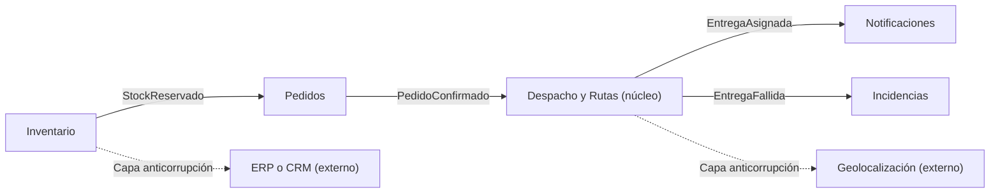
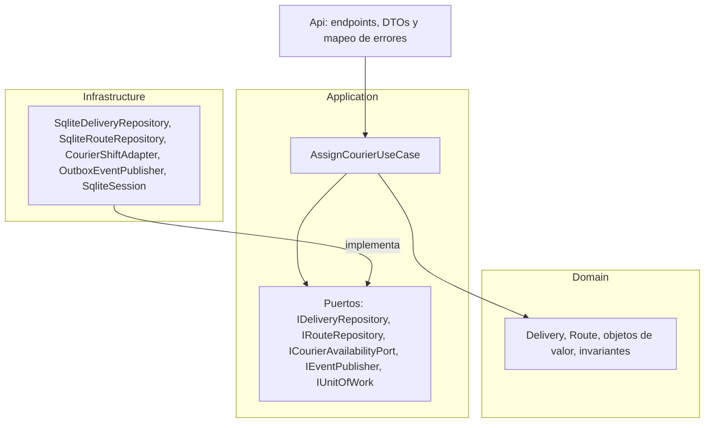

# LastMile Hub

## Resumen ejecutivo

**Producto.** LastMile Hub, plataforma centralizada de gestión logística de última milla para una empresa de retail digital.

**Problema.** La empresa recibe pedidos desde varios canales, maneja inventarios distribuidos y coordina entregas con
diferentes rutas y repartidores, pero no cuenta con una vista centralizada del estado real de cada pedido.
Esto genera duplicación de información, retrasos, errores operativos y poca trazabilidad. Además, la plataforma debe
admitir ventanas de entrega y picos de demanda sin interrumpir a los clientes actuales.

**Usuarios.** Cliente, operador de comercio o tienda, administrador de almacén, repartidor y soporte al cliente.

**Alcance.** Registro de pedidos, validación de inventario, asignación de rutas y repartidores, rastreo de entregas,
notificaciones e incidencias. Quedan fuera el procesamiento de pagos, la optimización de rutas con inteligencia
artificial, la facturación electrónica y las compras a proveedores.

## Requisitos prioritarios

| ID | Requisito | Por qué importa |
|---|---|---|
| RF-01 | Registrar pedidos desde múltiples canales | Es la entrada de todo el negocio |
| RF-02 | Validar inventario antes de confirmar un pedido | Evita prometer lo que no hay |
| RF-05 | Gestionar ventanas de entrega | Es una necesidad explícita del planteamiento |
| RF-06 | Rastrear el estado del pedido en tiempo real | Resuelve la falta de vista única |
| RF-10 | Sincronizar con el ERP o CRM | El ERP es la fuente maestra de productos y stock |
| RNF-02 | Disponibilidad | No se puede interrumpir a los clientes actuales |
| RNF-03 | Escalabilidad | Los picos de demanda no pueden degradar el servicio |
| RNF-04 | Seguridad | Hay datos personales de clientes |
| RNF-06 | Facilidad de evolución | Las reglas de negocio cambiarán |

## Decisión arquitectónica

**Monolito modular con dominios bien separados** (Pedidos, Inventario, Despacho y Rutas, Notificaciones e Incidencias).
Reduce riesgo y costo frente a microservicios, mantiene la consistencia entre pedidos e inventario y cubre los picos
con réplicas, colas y despliegues progresivos. Se reconsideraría si los picos superan lo que logran las réplicas o
si un módulo necesita escalar o cambiar a un ritmo distinto.

## Diseño de dominio: asignar un repartidor a una entrega

El flujo parte de una entrega **lista para despacho** y termina con la entrega **asignada** a un repartidor y a una
ruta, publicando el evento `EntregaAsignada`.

| ID | Invariante |
|---|---|
| INV-01 | Una entrega solo tiene un repartidor activo |
| INV-02 | Solo se asigna una entrega lista para despacho |
| INV-03 | Una ruta no supera su capacidad |
| INV-04 | Solo se asigna a un repartidor disponible |
| INV-05 | Una entrega no puede estar en dos estados a la vez |
| INV-06 | Una entrega cancelada o entregada no se asigna |

**Contextos y contratos:**



**Capas y dependencias** (las flechas apuntan hacia el dominio):



## Implementación del flujo (vertical slice)

El flujo está implementado de punta a punta:

```
POST /api/deliveries/{id}/assignment
  Api (endpoint, DTO, validación, mapeo de errores)
  -> Application (AssignCourierUseCase y puertos)
  -> Domain (Delivery y Route con las invariantes)
  -> Infrastructure (SQLite, outbox y adaptador de turnos) a través de los puertos
```

| Capa | Proyecto | Depende de |
|---|---|---|
| Domain | `src/LastMileHub.Domain` | nada |
| Application | `src/LastMileHub.Application` | Domain |
| Infrastructure | `src/LastMileHub.Infrastructure` | Application |
| Api | `src/LastMileHub.Api` | Infrastructure (solo para componer las dependencias) |
| Pruebas | `tests/LastMileHub.Tests` | todas |

### Requisitos

SDK de .NET 8 o superior (si usas otra versión, cambia `TargetFramework` en `Directory.Build.props`).

### Cómo ejecutar

```
dotnet restore
dotnet build
dotnet test
```

Para levantar la API con datos de demostración:

```
# PowerShell
$env:Seed__Demo="true"; dotnet run --project src/LastMileHub.Api --urls http://localhost:5080

# Linux, macOS o Git Bash
Seed__Demo=true dotnet run --project src/LastMileHub.Api --urls http://localhost:5080
```

Las migraciones (`src/LastMileHub.Infrastructure/Migrations/*.sql`) se aplican solas al arrancar y quedan
registradas en la tabla `schema_version`. La base de datos es el archivo `lastmilehub.db`, que se ignora en git.
Para reiniciar la demostración, detén la API y borra ese archivo.

### Escenarios de demostración

Se ejecutan con el archivo `requests.http` (extensión REST Client de VS Code), en este orden:

| Escenario | Entrega | Repartidor | Ruta | Resultado |
|---|---|---|---|---|
| Éxito | 1111... | aaaa... | cccc... | 200 |
| Asignación duplicada | 1111... | aaaa... | cccc... | 409 `DELIVERY_ALREADY_ASSIGNED` |
| Entrega inexistente | 9999... | aaaa... | cccc... | 404 `DELIVERY_NOT_FOUND` |
| Repartidor fuera de turno | 2222... | bbbb... | cccc... | 422 `COURIER_NOT_AVAILABLE` |
| Ruta saturada | 3333... | aaaa... | dddd... | 409 `ROUTE_SATURATED` |
| Entrega cancelada | 4444... | aaaa... | cccc... | 409 `DELIVERY_NOT_ASSIGNABLE` |

### Pruebas

| Tipo | Archivo | Qué comprueba |
|---|---|---|
| Unitarias de dominio | `DomainTests.cs` | INV-01, INV-02, INV-03 e INV-06 |
| Caso de uso con dobles | `AssignCourierUseCaseTests.cs` | Orquestación, errores y ausencia de efectos secundarios |
| Integración | `AssignCourierApiTests.cs` | Endpoint, dominio y SQLite real; errores 404, 409, 422, 503 y 400 |
| Arquitectura | `ArchitectureTests.cs` | Dirección de las dependencias entre capas |

El flujo de integración continua (`.github/workflows/ci.yml`) compila, ejecuta las pruebas, revisa
vulnerabilidades en dependencias y guarda el reporte de resultados.

### Riesgos y observabilidad

Los riesgos operativos y de seguridad, sus mitigaciones y la evidencia de verificación están en
`docs/actividad-4/registro-actividad-4.md`. La observabilidad usa logs estructurados con identificador de
correlación, métricas de asignaciones y un endpoint `/health`, sin registrar datos personales.
