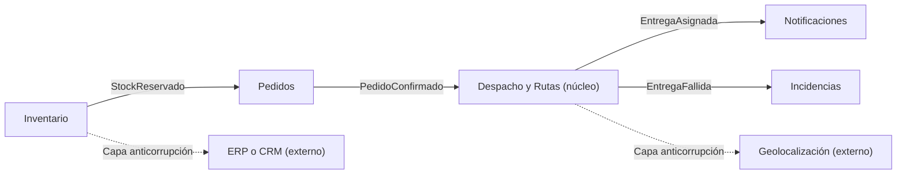
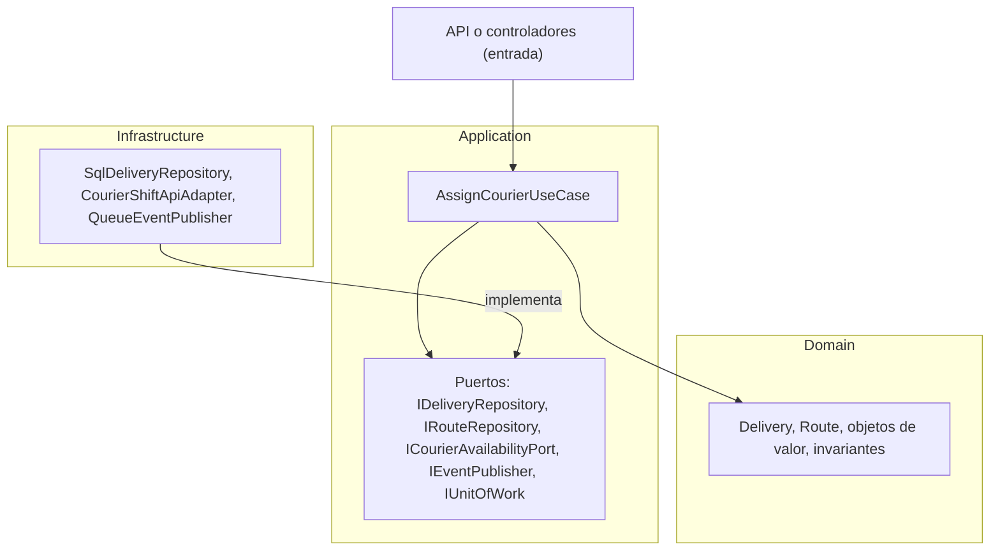

# LastMile Hub

## Resumen ejecutivo

**Producto.** LastMile Hub, plataforma centralizada de gestión logística de última milla para una empresa de retail digital.

**Problema.** La empresa recibe pedidos desde varios canales, maneja inventarios distribuidos y coordina entregas con
diferentes rutas y repartidores, pero no cuenta con una vista centralizada del estado real de cada pedido.
Esto genera duplicación de información, retrasos, errores operativos y poca trazabilidad. Además, la plataforma debe
admitir ventanas de entrega y picos de demanda sin interrumpir a los clientes actuales.

**Usuarios.** Cliente, operador de comercio o tienda, administrador de almacén, repartidor y soporte al cliente.

**Alcance.** Registro de pedidos, validación de inventario, asignación de rutas y repartidores, rastreo de entregas,
notificaciones e incidencias. Quedan fuera el procesamiento de pagos, la optimización de rutas con inteligencia
artificial, la facturación electrónica y las compras a proveedores.

## Requisitos prioritarios

| ID | Requisito | Por qué importa |
|---|---|---|
| RF-01 | Registrar pedidos desde múltiples canales | Es la entrada de todo el negocio |
| RF-02 | Validar inventario antes de confirmar un pedido | Evita prometer lo que no hay |
| RF-05 | Gestionar ventanas de entrega | Es una necesidad explícita del planteamiento |
| RF-06 | Rastrear el estado del pedido en tiempo real | Resuelve la falta de vista única |
| RF-10 | Sincronizar con el ERP o CRM | El ERP es la fuente maestra de productos y stock |
| RNF-02 | Disponibilidad | No se puede interrumpir a los clientes actuales |
| RNF-03 | Escalabilidad | Los picos de demanda no pueden degradar el servicio |
| RNF-04 | Seguridad | Hay datos personales de clientes |
| RNF-06 | Facilidad de evolución | Las reglas de negocio cambiarán |

## Decisión arquitectónica

**Monolito modular con dominios bien separados** (Pedidos, Inventario, Despacho y Rutas, Notificaciones e Incidencias).
Reduce riesgo y costo frente a microservicios, mantiene la consistencia entre pedidos e inventario y cubre los picos
con réplicas, colas y despliegues progresivos. Se reconsideraría si los picos superan lo que logran las réplicas o
si un módulo necesita escalar o cambiar a un ritmo distinto.

## Diseño de dominio: asignar un repartidor a una entrega

El flujo elegido parte de una entrega **lista para despacho** y termina con la entrega **asignada** a un repartidor
y a una ruta, publicando el evento `EntregaAsignada`.

**Modelo.** Entidades `Delivery` y `Route` (raíces de agregado); objetos de valor `DeliveryId`, `CourierId`,
`RouteId`, `DeliveryAddress` y `DeliveryStatus`.

**Invariantes.**

| ID | Regla |
|---|---|
| INV-01 | Una entrega solo tiene un repartidor activo |
| INV-02 | Solo se asigna una entrega lista para despacho |
| INV-03 | Una ruta no supera su capacidad |
| INV-04 | Solo se asigna a un repartidor disponible |
| INV-05 | Una entrega no puede estar en dos estados a la vez |
| INV-06 | Una entrega cancelada o entregada no se asigna |

**Contextos y contratos.** Cinco contextos que se comunican por eventos:



**Capas y dependencias.** Tres capas con las dependencias hacia el dominio:



**Puertos y adaptadores.**

| Puerto | Adaptador propuesto |
|---|---|
| `IDeliveryRepository` | `SqlDeliveryRepository` |
| `IRouteRepository` | `SqlRouteRepository` |
| `ICourierAvailabilityPort` | `CourierShiftApiAdapter` |
| `IEventPublisher` | `QueueEventPublisher` |
| `IUnitOfWork` | `SqlUnitOfWork` |

**Decisiones de diseño.** ADR-001 (estructura) y ADR-002 (dominio, puertos y adaptadores). Los diagramas C4
actualizados están en la documentación de la actividad.

## Cómo ejecutar las pruebas

Requiere el SDK de .NET 8 o superior:

```
dotnet test
```
