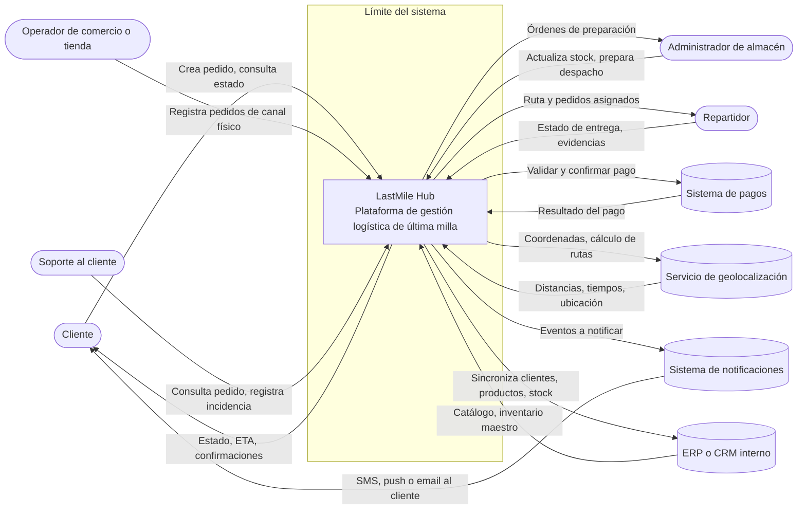

# B. Diagrama de contexto

Muestra al usuario, el sistema principal, los sistemas externos, los flujos de información y los límites del sistema.

## Elementos

| Elemento | Descripción |
|---|---|
| Actores | Cliente, operador de comercio o tienda, administrador de almacén, repartidor, soporte al cliente |
| Sistema principal | LastMile Hub, dentro del recuadro "Límite del sistema" |
| Sistemas externos | Pagos, geolocalización, notificaciones, ERP o CRM |
| Flujos de información | Flechas con su etiqueta |
| Límites | Todo lo que está dentro del recuadro se construye; lo que está fuera se integra por interfaces |