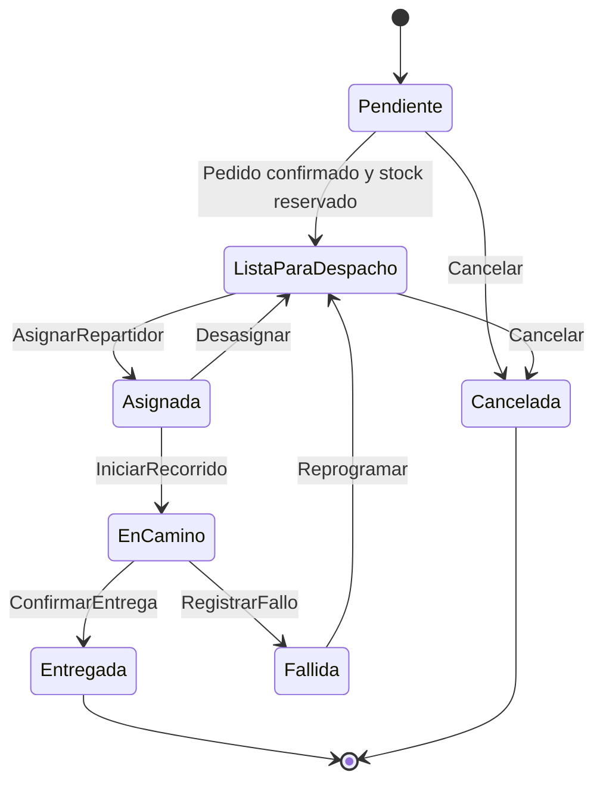

# Modelo de dominio

## Entidades (tienen identidad propia)

| Entidad | Identidad | Responsabilidad |
|---|---|---|
| **Delivery (Entrega)**, raíz del agregado | `DeliveryId` | Controla su estado y protege que tenga un solo repartidor activo |
| **Route (Ruta)**, raíz del agregado | `RouteId` | Controla su capacidad y las entregas que contiene |
| **Courier (Repartidor)** | `CourierId` | Representa al repartidor; su disponibilidad se consulta por un puerto |
| **Order (Pedido)**, del contexto Pedidos | `OrderId` | Despacho solo lo referencia por identificador |

## Objetos de valor (se describen por sus atributos, sin identidad propia)

| Objeto de valor | Descripción |
|---|---|
| `DeliveryId`, `CourierId`, `RouteId`, `OrderId` | Identificadores tipados, para no mezclar un id con otro |
| `DeliveryAddress` | Dirección de entrega; no puede estar vacía |
| `DeliveryWindow` | Inicio y fin del rango horario de entrega |
| `RouteCapacity` | Máximo de entregas de una ruta (en el código es el entero `Capacity` de `Route`) |
| `DeliveryStatus` | Estado de la entrega |

## Estados y transiciones de `Delivery`

| Transición | Cuándo ocurre |
|---|---|
| Pendiente a ListaParaDespacho | El pedido se confirma y el stock queda reservado |
| **ListaParaDespacho a Asignada** | **Se asigna un repartidor (flujo de esta actividad)** |
| Asignada a ListaParaDespacho | Se desasigna al repartidor |
| Asignada a EnCamino | El repartidor inicia el recorrido |
| EnCamino a Entregada | Se confirma la entrega |
| EnCamino a Fallida | Se registra un intento fallido |
| Fallida a ListaParaDespacho | Se reprograma la entrega |
| Pendiente o ListaParaDespacho a Cancelada | Se cancela el pedido |

## Agregados
`Delivery` y `Route` son agregados separados. Un agregado solo se modifica a través de su raíz, que protege sus
invariantes. Se referencian entre sí por identificador, no por objeto.
