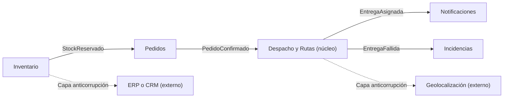

# Contextos delimitados y contratos

## Contextos (cada uno es un módulo del monolito)

| Contexto | Responsabilidad | Modelo propio |
|---|---|---|
| **Pedidos** | Registrar, validar y confirmar pedidos | Pedido, LíneaPedido, Cliente |
| **Inventario** | Stock, reservas y almacenes | Inventario, Almacén, Reserva |
| **Despacho y Rutas** (núcleo) | Entregas, rutas, repartidores y asignación | Entrega, Ruta, Repartidor |
| **Notificaciones** | Avisar al cliente y al repartidor | Notificación, Plantilla |
| **Incidencias** | Reclamos y entregas fallidas | Incidencia, Resolución |

Sistemas externos: pagos, geolocalización, ERP o CRM. Un mismo concepto cambia de significado según el contexto:
"pedido" en Pedidos tiene líneas y precios; en Despacho es solo un identificador, una dirección y una ventana.

## Mapa de contextos

## Relaciones
- **Pedidos a Despacho:** cliente y proveedor. Despacho solo recibe el identificador del pedido, la dirección y la ventana, nunca la entidad completa.
- **Despacho a Notificaciones e Incidencias:** lenguaje publicado mediante eventos. Notificaciones no conoce las reglas de Despacho.
- **Geolocalización y ERP:** se integran por una **capa anticorrupción** (adaptador) para que sus modelos no contaminen el dominio.

## Contratos que se intercambian

| Contrato | Dirección | Contenido |
|---|---|---|
| `PedidoConfirmado` | Pedidos a Despacho | OrderId, DeliveryAddress, DeliveryWindow |
| `EntregaAsignada` | Despacho a Notificaciones | DeliveryId, CourierId, RouteId, ventana |
| `EntregaFallida` | Despacho a Incidencias y Notificaciones | DeliveryId, motivo |
