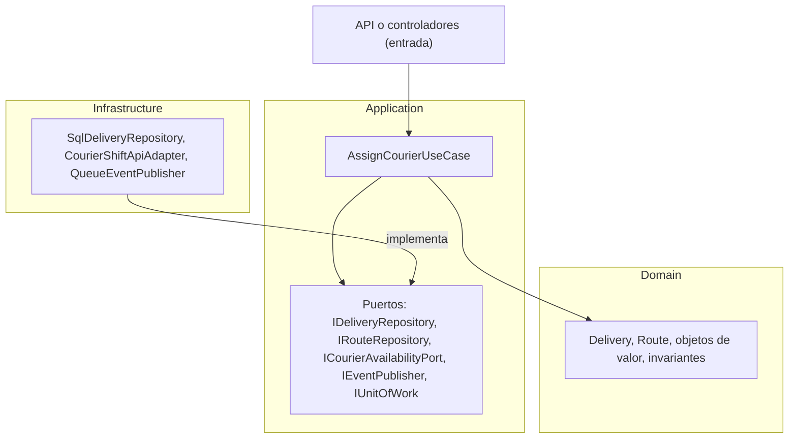

# Casos de uso, contratos, puertos y adaptadores

## Casos de uso del contexto Despacho

| Caso de uso | Intención |
|---|---|
| **AssignCourierUseCase** (el modelado) | Asignar un repartidor a una entrega |
| UnassignCourierUseCase | Quitar la asignación |
| StartDeliveryUseCase | Marcar la entrega en camino |
| ConfirmDeliveryUseCase | Registrar una entrega exitosa |
| RegisterFailedDeliveryUseCase | Registrar un intento fallido |

Cada caso de uso tiene una intención clara y no se mezcla con detalles de base de datos ni de HTTP.

## Contrato de aplicación de `AssignCourierUseCase`

| Elemento | Detalle |
|---|---|
| Entrada | `AssignCourierCommand(DeliveryId, CourierId, RouteId)` |
| Salida exitosa | `AssignCourierResult(DeliveryId, CourierId, RouteId, Status)` |
| Errores de negocio | `DeliveryNotFound`, `RouteNotFound`, `CourierNotAvailable`, `DeliveryNotAssignable`, `DeliveryAlreadyAssigned`, `RouteSaturated` |
| Efectos | Persiste la entrega y la ruta y publica `DeliveryAssigned` |

## Pasos del caso de uso

1. Cargar la entrega mediante `IDeliveryRepository`.
2. Cargar la ruta mediante `IRouteRepository`.
3. Consultar la disponibilidad del repartidor mediante un puerto, no mediante una API concreta.
4. Ejecutar `delivery.AssignCourier(...)` y `route.AddDelivery(...)`, que protegen las invariantes.
5. Guardar ambos agregados dentro de una unidad de trabajo (`IUnitOfWork`).
6. Publicar el evento mediante `IEventPublisher`.

## Puertos y adaptadores

El dominio y la aplicación definen la necesidad (puerto). La infraestructura implementa el detalle (adaptador).

| Puerto (interfaz, en Application) | Adaptador propuesto (en Infrastructure) | Tecnología posible |
|---|---|---|
| `IDeliveryRepository` | `SqlDeliveryRepository` | Base de datos SQL |
| `IRouteRepository` | `SqlRouteRepository` | Base de datos SQL |
| `ICourierAvailabilityPort` | `CourierShiftApiAdapter` | API del sistema de turnos o del ERP |
| `IEventPublisher` | `QueueEventPublisher` | Cola de mensajes |
| `IUnitOfWork` | `SqlUnitOfWork` | Transacción de base de datos |

Los adaptadores se implementan en la Actividad 4. En esta actividad solo se definen los puertos y se prueba el
caso de uso con dobles en memoria.

## Dirección de las dependencias

Regla: **Domain no depende de nada**; Application depende de Domain; Infrastructure depende de Application
(implementa sus puertos); la API depende de Application. Las flechas siempre apuntan hacia el dominio.

## Dónde está en el código

| Concepto | Archivo |
|---|---|
| Entidades y objetos de valor | `src/LastMileHub.Domain/Dispatch/` |
| Puertos | `src/LastMileHub.Application/Dispatch/Ports.cs` |
| Caso de uso y contratos | `src/LastMileHub.Application/Dispatch/AssignCourierUseCase.cs` |
| Pruebas | `tests/LastMileHub.Tests/` |
