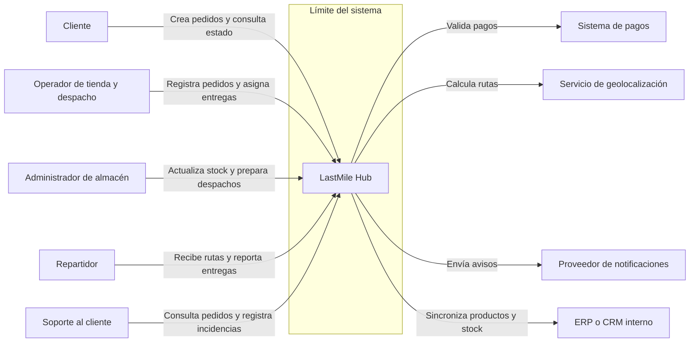
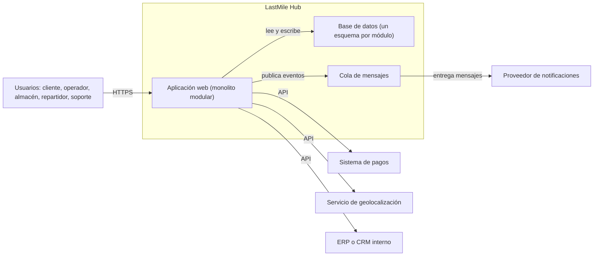
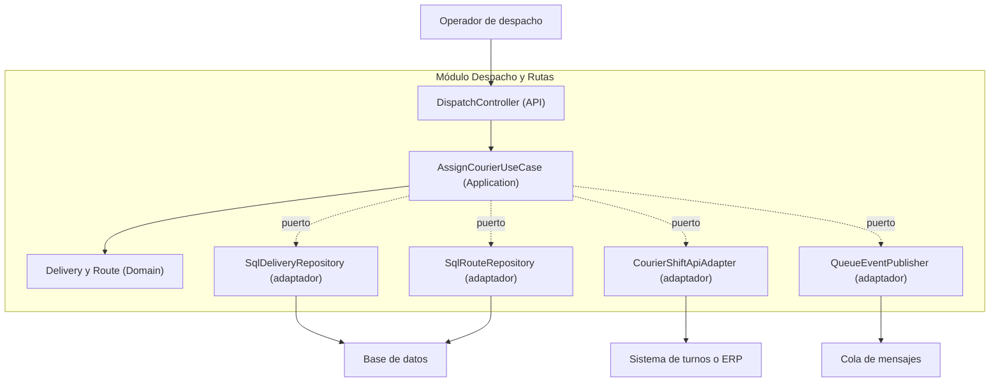

# Diagramas C4 actualizados

## Nivel 1: contexto del sistema

## Nivel 2: contenedores

El sistema es un monolito modular (ADR-001): una aplicación con varios módulos, una base de datos y una cola.

## Nivel 3: componentes del módulo Despacho y Rutas

Muestra el flujo de asignar un repartidor. Las líneas punteadas son los puertos que implementan los adaptadores.

