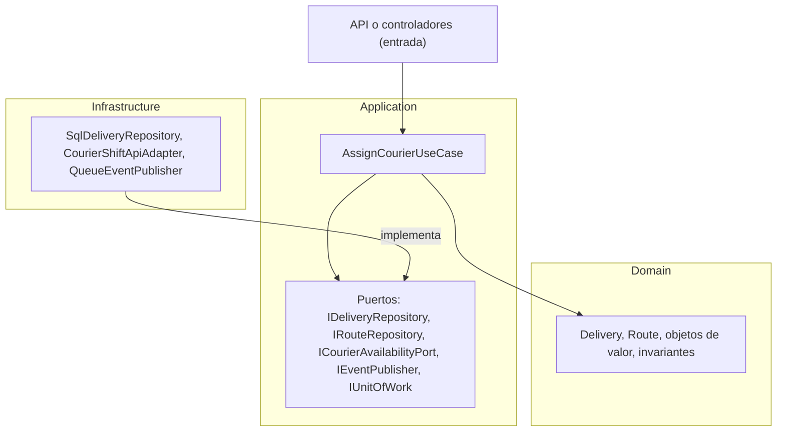

# Dirección de las dependencias

Las flechas indican quién depende de quién. Domain no depende de nada; Application depende de Domain; Infrastructure implementa los puertos que define Application.

