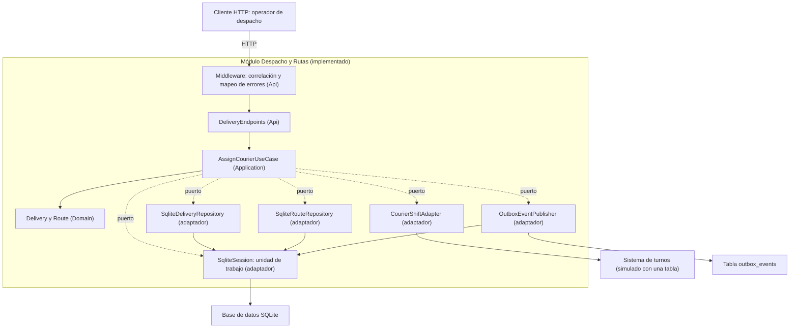

# Diagrama C4 nivel 3 actualizado: módulo Despacho y Rutas implementado

Actualiza el diagrama de componentes de la Actividad 3 con los nombres reales de la implementación.
Las líneas punteadas son los puertos definidos en Application que implementan los adaptadores.

## Cambios frente al diseño de la Actividad 3

| Diseño (Actividad 3) | Implementación (Actividad 4) | Motivo |
|---|---|---|
| `SqlDeliveryRepository` | `SqliteDeliveryRepository` | Se eligió SQLite para poder ejecutar todo sin infraestructura externa (ADR-003) |
| `SqlRouteRepository` | `SqliteRouteRepository` | Igual |
| `QueueEventPublisher` | `OutboxEventPublisher` | El evento se guarda en una tabla outbox dentro de la misma transacción |
| `SqlUnitOfWork` | `SqliteSession` | Una conexión y transacción por petición |
| `CourierShiftApiAdapter` | `CourierShiftAdapter` | El sistema de turnos se simula con una tabla local |
| (no existía) | `Middleware` | Correlación de peticiones y traducción de errores a respuestas controladas |
